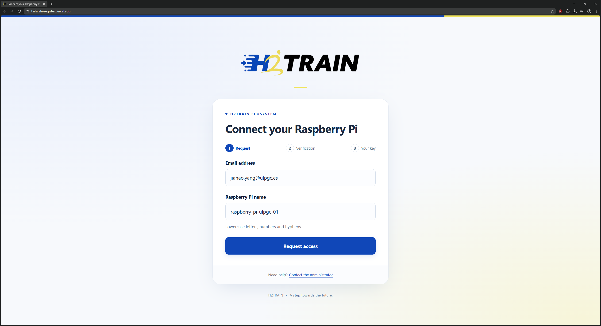
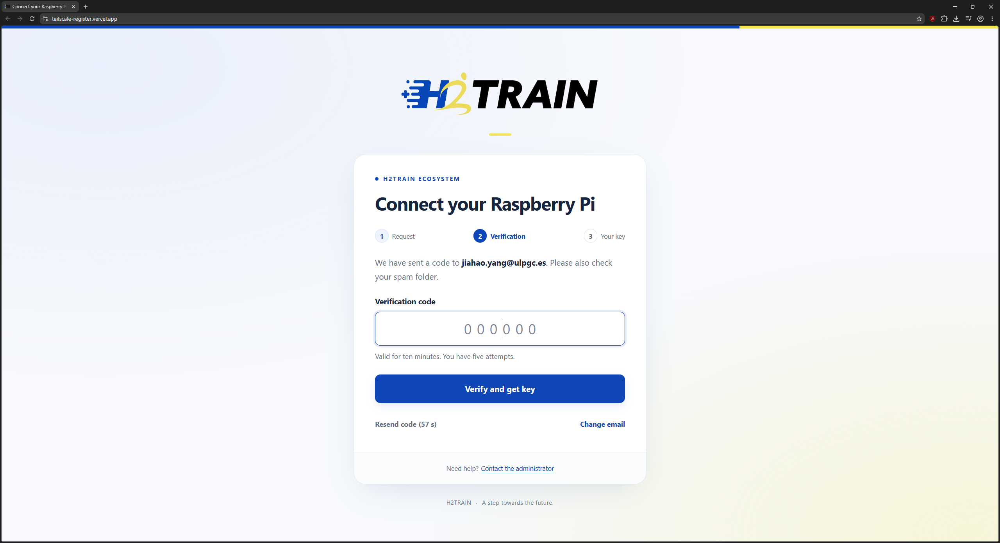
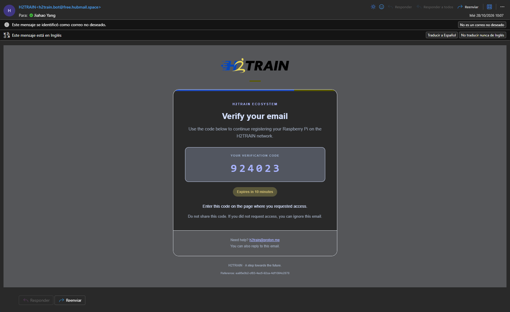
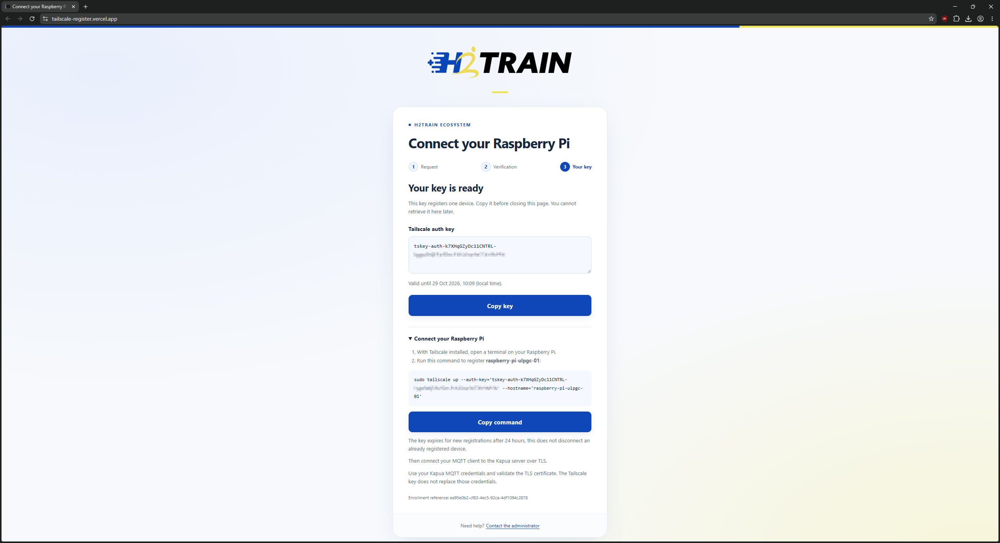

# 2. Hardware, Software, and Prerequisites

This chapter defines the hardware and software prerequisites for installing
Eclipse Kura. It describes the equipment and operating environment used
successfully in the current implementation.

Devices with similar capabilities may also be suitable. However, their operating
system, processor architecture, and compatibility with the selected Kura package
must be checked before applying the installation procedure.

## 2.1 Hardware Requirements

The current implementation uses a **Raspberry Pi 4 Model B with 4 GB of RAM**.
The following table summarizes the specifications of the hardware used; it does
not define the minimum requirements for every Kura deployment.

| Component | Specification |
| --- | --- |
| Processor | Broadcom BCM2711, quad-core Cortex-A72 (ARMv8), 64-bit SoC at 1.8 GHz |
| Memory | 4 GB LPDDR4-3200 SDRAM in the model used |
| Wireless connectivity | 2.4 GHz and 5.0 GHz IEEE 802.11ac Wi-Fi, Bluetooth 5.0, and Bluetooth Low Energy (BLE) |
| Wired connectivity | Gigabit Ethernet |
| USB ports | Two USB 3.0 ports and two USB 2.0 ports |
| Display outputs | Two micro-HDMI ports, supporting up to 4K at 60 frames per second |
| Display interface | Two-lane MIPI DSI display port |
| Camera interface | Two-lane MIPI CSI camera port |
| Audio and composite video | Four-pole stereo audio and composite video port |
| Video processing | H.265 decoding at 4K/60 fps; H.264 decoding at 1080p/60 fps and encoding at 1080p/30 fps |
| Storage | microSD card slot for the operating system and data storage |
| USB-C power input | 5 V DC, with a supply rated for at least 3 A |
| Alternative power input | 5 V DC through the GPIO header, with a supply rated for at least 3 A |

For further specifications, consult the
[official Raspberry Pi 4 Model B product page](https://www.raspberrypi.com/products/raspberry-pi-4-model-b/).

Provide a microSD card for the operating system and a suitable power supply.
The USB-C and GPIO entries above describe alternative power inputs.

## 2.2 Peripherals and Network Connectivity

For local setup and interaction with the Raspberry Pi, a keyboard, mouse, and
display with a suitable micro-HDMI cable or adapter are recommended. Remote
administration through SSH is also possible once network access and SSH have
been configured.

Configure at least one network interface before starting the installation:

- **Ethernet:** connect the device to the network using an Ethernet cable.
- **Wi-Fi:** configure the wireless network and verify that the device can connect.

Internet access is required to update system packages and download Kura and its
dependencies.

## 2.3 Operating System

The current implementation uses **Raspberry Pi OS based on Debian 13 (Trixie)**.
Raspberry Pi OS was previously known as Raspbian. Official images are available
from the [Raspberry Pi OS download page](https://www.raspberrypi.com/software/operating-systems/).

Use the **64-bit edition** for the procedure in
[Chapter 3: Installing Eclipse Kura](03-installing-eclipse-kura.md), which uses
the `aarch64` installer. The Adoptium repository configured in that chapter also
targets the `trixie` release.

## 2.4 User Accounts and Administrative Permissions

The device must have a user account that can execute commands with administrative
privileges through `sudo`. These privileges are needed to install packages,
configure repositories, and restart the device.

Confirm that the account can use `sudo` before beginning the installation.

## 2.5 Software Requirements

This section covers system preparation and the temporary VPN setup required to
connect Eclipse Kura and Eclipse Kapua from different geographical locations.

### 2.5.1 Prepare the System

Update the package lists and upgrade installed system packages before installing
Kura. The commands are provided in section 3.1.

An existing Kura or Java installation is not required: Chapter 3 covers the
installation of Eclipse Temurin JDK 17, the required utilities, and Eclipse Kura
5.6.2. Ensure that `wget` is available before the installer download step in
section 3.2. For the current remote connectivity setup, also install and configure
Tailscale as described below.

### 2.5.2 Understand the Temporary VPN Setup

The planned deployment will host Eclipse Kapua on a cloud server with a DNS name
that resolves to an address reachable from users' networks. This solution is not
yet available in the current implementation.

Until that deployment is available, Tailscale provides a shared private network
between the Kura device and the Kapua server, allowing them to communicate from
different locations. Tailscale was selected for this temporary solution because
it offers a free tier for connecting multiple devices. 

To connect a device to the H2Train Tailscale network, first install Tailscale on
the device. Then request an **auth key**, verify your email address, and use the
issued key to join the network, following the steps below.

### 2.5.3 Install Tailscale

Install Tailscale on the Raspberry Pi before requesting an auth key. Open a
terminal on the device. If `curl` is not available, install it first with
`sudo apt install -y curl`.

Run the following command to download and execute the official Tailscale
installation script:

```bash
curl -fsSL https://tailscale.com/install.sh | sh
```

For further installation details, consult the
[official Tailscale Linux installation guide](https://tailscale.com/docs/install/linux).

Once installation is complete, proceed to
[section 2.5.4](#254-request-an-auth-key) to request the auth key needed to register
the device on the H2Train network.

### 2.5.4 Request an Auth Key

The registration service issues auth keys to authorized users whose institutional
email addresses are included in an approved list (whitelist).

1. Open the [H2Train Tailscale registration page](https://tailscale-register.vercel.app/).
2. Enter your institutional email address in **Email address**.
3. Enter a name for the device in **Raspberry Pi name**, using lowercase letters,
   numbers, and hyphens.
4. Select **Request access** to begin email verification.

The following example uses `jiahao.yang@ulpgc.es` and the device name
`raspberry-pi-ulpgc-01`. Replace these example values with your own email address
and device name.



After submitting the request, continue with email verification in
[section 2.5.5](#255-verify-your-email-address).

### 2.5.5 Verify Your Email Address

The registration service sends a six-digit verification code to the email
address provided, using an external SMTP server. The page then displays the
verification form shown below.



1. Open your email application and locate the verification message.
2. If the message is not in your inbox, check the **Junk** or **Spam** folder.
3. Copy the six-digit code from the message.
4. Return to the registration page, enter the code in **Verification code**, and
   select **Verify and get key**.

The following screenshot shows an example of the verification email. Use the
code sent to your own email address.



After successful verification, the final step of the registration process
displays the Tailscale auth key and the device registration command, as shown
below. Copy the key or the complete command directly from this page to register
your device.



Use the command displayed in this final step to connect the device as described
in [section 2.5.6](#256-connect-the-device-to-the-tailscale-network).

### 2.5.6 Connect the Device to the Tailscale Network

With Tailscale installed and your auth key available, complete the device
registration:

1. Copy the device registration command provided by the H2Train registration page.
2. Paste and run it in the Raspberry Pi terminal. Use the command containing your
   newly issued auth key.
3. Confirm that the device has joined the Tailscale network by running:

   ```bash
   tailscale status
   ```

This command displays the device's Tailscale connection status and the peers
visible to it on the network.

### 2.5.7 Request Assistance

If the service cannot issue an auth key, or if your email address is not included
in the whitelist, contact the system administrator at
[h2train@proton.me](mailto:h2train@proton.me).

Include your institutional email address, the intended device name, and a brief
description of the problem. The administrator will review the request and provide
assistance, including an appropriate auth key once access has been authorized.
