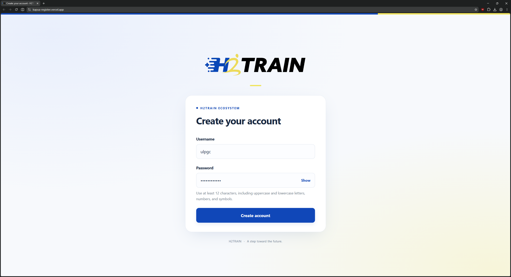
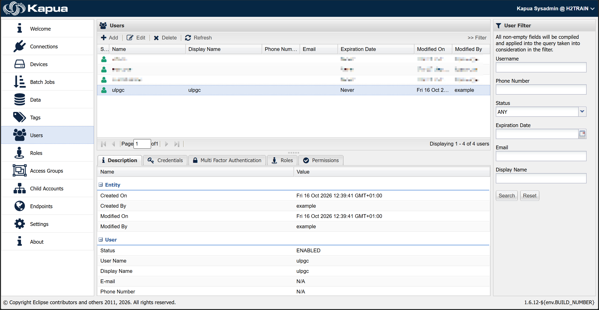
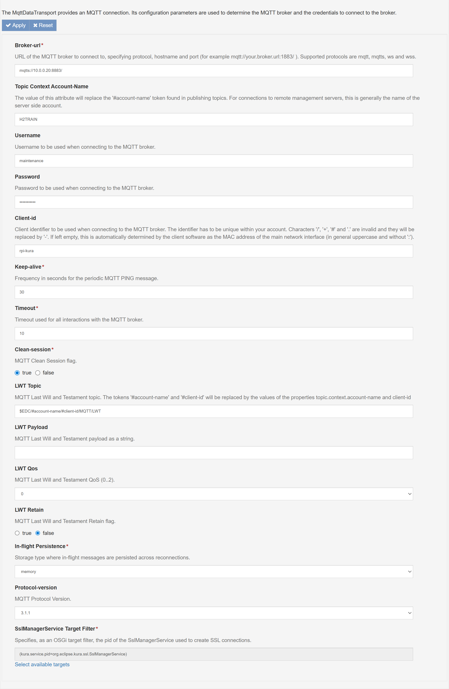
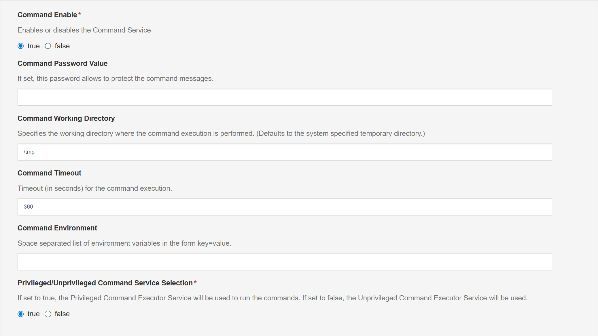

# 4. Connecting to Cloud Multiplatform H2Train with Eclipse Kapua

This chapter describes how to register a Kapua user and configure Eclipse Kura
for device maintenance through Cloud Multiplatform H2Train. Complete the steps
in the order presented, using the connection settings for the deployment
described below.

## 4.1 Register a Kapua User

Before configuring the device, create a user on the Kapua server through the
[Kapua registration page](https://kapua-register.vercel.app/). This application
is hosted on Vercel and uses the Kapua API to create new users.

1. Open the registration page.
2. Enter a username and choose a password.
3. Submit the registration form. The system assigns the user's role automatically.

The following example shows the registration of a user named `ulpgc` with a
password chosen by the user.

Once registration is complete, confirm in the Kapua administration console that
the user has been created successfully, as illustrated below.

Registration provides each user with individual credentials for broker
authentication. The maintenance connection configured in section 4.5 uses a
dedicated maintenance account with its own roles and permissions.

## 4.2 Import the SSL Certificate into Kura

Download the SSL certificate provided in the
[deployment certificate Gist](https://gist.github.com/PhalanXinho/8a4f244f9a75e731508249004db45940).
Then import it through the Kura administration console:

1. Open the **Security** section.
2. Select **Add**, then **Certificate**.
3. Select **SSLKeystore** as the destination keystore.
4. Select the downloaded certificate file and complete the import.

The certificate is used to establish trust for the secure connection to the broker.

## 4.3 Create the Maintenance Cloud Connection

In the Kura administration console, open **Cloud Connections** and select
**New Connection**. Configure the connection as follows:

| Field | Value |
| --- | --- |
| Cloud Connection Factory PID | `org.eclipse.kura.cloud.CloudService` |
| Cloud Connection Service PID | `org.eclipse.kura.cloud.CloudService-Maintainer` |

Create the connection, then continue with its data service configuration.

## 4.4 Enable Automatic Connection at Startup

Open the **DataService-Maintainer** section of the new cloud connection.

1. Set **Connect Auto-on-Startup** to `true`.
2. Select **Apply** to save the changes.
3. Open **MqttDataTransport-Maintainer** to configure the broker connection.

## 4.5 Configure the MQTT Transport

Configure **MqttDataTransport-Maintainer** using the values shown below and in
the accompanying screenshot.

| Field | Value |
| --- | --- |
| Broker-url | `mqtts://10.0.0.20:8883/` |
| Topic Context Account-Name | `H2TRAIN` |
| Username | `maintenance` |
| Password | `1234` |
| Client-id | `rpi-kura`, or another identifier unique within the account |
| Keep-alive | `30` seconds |
| Timeout | `10` seconds |
| Clean-session | `true` |

Use the dedicated `maintenance` account for this connection. Its roles and
permissions are intended for maintenance-related communication. Enter `1234`
as the password for the deployment described in this chapter.

The **Client-id** may be changed to identify the device. Keep all other settings
as shown in the screenshot, then select **Apply** to save the configuration.

## 4.6 Configure the Command Service

Select **CommandService** in the left navigation panel. Configure the service
as shown in the following screenshot, entering `1234` in **Command Password Value**.

| Field | Value |
| --- | --- |
| Command Enable | `true` |
| Command Password Value | `1234` |
| Command Working Directory | `/tmp` |
| Command Timeout | `360` seconds |
| Command Environment | Leave empty |
| Privileged/Unprivileged Command Service Selection | `true` |

Keep the remaining settings as shown and select **Apply** to save the changes.

## 4.7 Configuration Outcome

These steps complete the Kura configuration for device maintenance in the
described deployment. User registration provides individual broker credentials,
while the dedicated maintenance cloud connection and Command Service provide
the configuration needed for a Kapua administrator to carry out remote
maintenance operations, including application updates.
