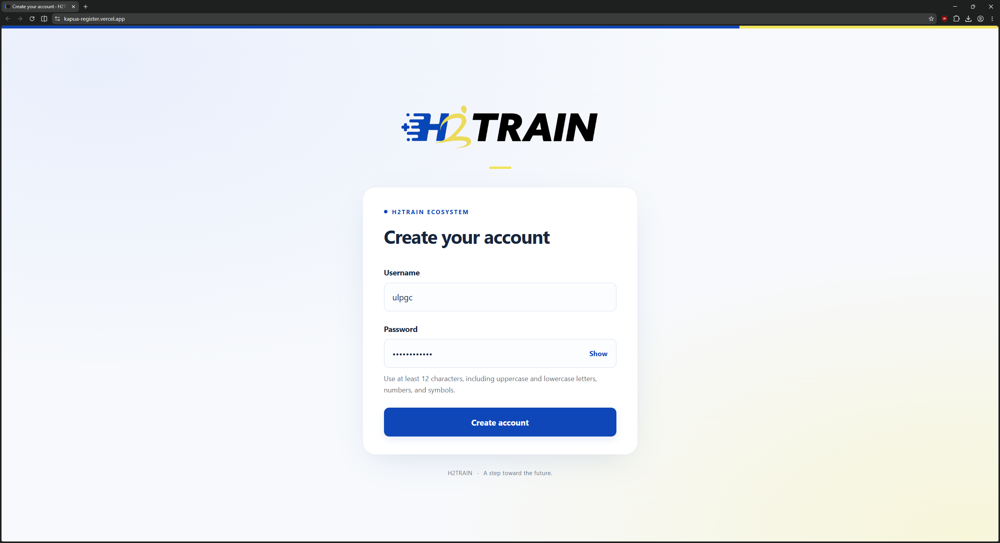
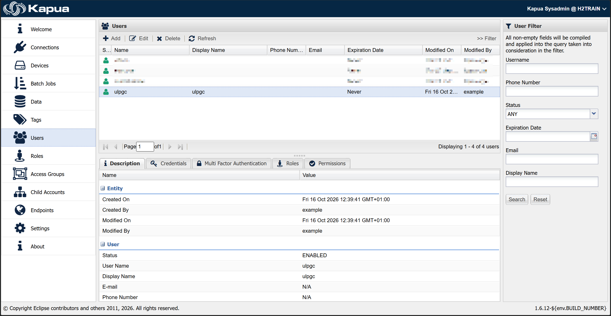
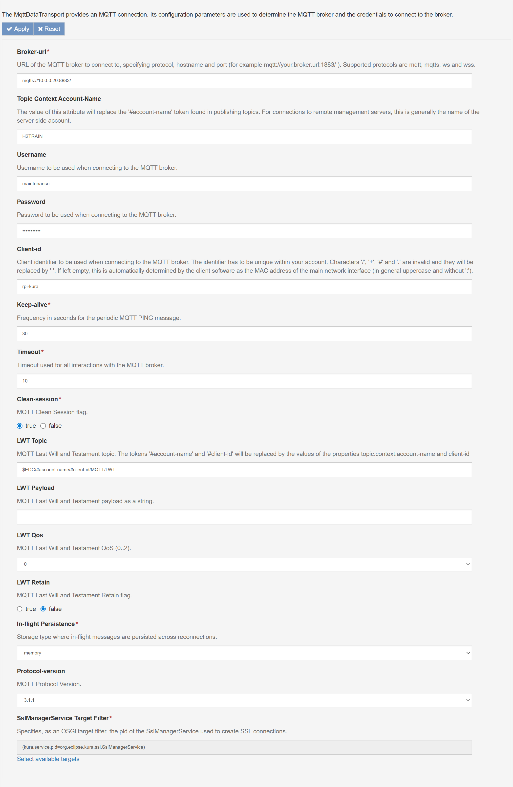

# 4. Connecting to Cloud Multiplatform H2Train with Eclipse Kapua

This chapter describes how to register a Kapua user and configure Eclipse Kura
for device maintenance through Cloud Multiplatform H2Train. Complete the steps
in the order presented, using the connection settings for the deployment
described below.

## 4.1 Register a Kapua User

Before configuring the device, create a user on the Kapua server through the
[Kapua registration page](https://kapua-register.vercel.app/). This application
is hosted on Vercel and uses the Kapua API to create new users.

1. Open the registration page.
2. Enter a username and choose a password.
3. Submit the registration form. The system assigns the user's role automatically.

The following example shows the registration of a user named `ulpgc` with a
password chosen by the user.



Once registration is complete, confirm in the Kapua administration console that
the user has been created successfully, as illustrated below.



Registration provides each user with individual credentials for broker
authentication. The maintenance connection configured in section 4.5 uses a
dedicated maintenance account with its own roles and permissions.

## 4.2 Import the SSL Certificate into Kura

Download the SSL certificate provided in the
[deployment certificate Gist](https://gist.github.com/PhalanXinho/8a4f244f9a75e731508249004db45940).
Then import it through the Kura administration console:

1. Open the **Security** section.
2. Select **Add**, then **Certificate**.
3. Select **SSLKeystore** as the destination keystore.
4. Select the downloaded certificate file and complete the import.

The certificate is used to establish trust for the secure connection to the broker.

## 4.3 Create the Maintenance Cloud Connection

In the Kura administration console, open **Cloud Connections** and select
**New Connection**. Configure the connection as follows:

| Field | Value |
| --- | --- |
| Cloud Connection Factory PID | `org.eclipse.kura.cloud.CloudService` |
| Cloud Connection Service PID | `org.eclipse.kura.cloud.CloudService-Maintainer` |

Create the connection, then continue with its data service configuration.

## 4.4 Enable Automatic Connection at Startup

Open the **DataService-Maintainer** section of the new cloud connection.

1. Set **Connect Auto-on-Startup** to `true`.
2. Select **Apply** to save the changes.
3. Open **MqttDataTransport-Maintainer** to configure the broker connection.

## 4.5 Configure the MQTT Transport

Configure **MqttDataTransport-Maintainer** using the values shown below and in
the accompanying screenshot.

| Field | Value |
| --- | --- |
| Broker-url | `mqtts://10.0.0.20:8883/` |
| Topic Context Account-Name | `H2TRAIN` |
| Username | `maintenance` |
| Password | Obtain the maintenance account password from the H2Train administrator. |
| Client-id | `rpi-kura`, or another identifier unique within the account |
| Keep-alive | `30` seconds |
| Timeout | `10` seconds |
| Clean-session | `true` |



Use the dedicated `maintenance` account for this connection. Its roles and
permissions are intended for maintenance-related communication. Obtain its
password from the H2Train administrator before applying the configuration.

The **Client-id** may be changed to identify the device. Keep all other settings
as shown in the screenshot, then select **Apply** to save the configuration.

## 4.6 Install the OSGi Notification Receiver

The update mechanism uses the Java OSGi component provided in the
[H2Train kura-receiver repository](https://github.com/H2TRAIN-Organization/kura-receiver).
It receives update offers from Kapua and makes them available to the local
application, Cardia, through a JSON file. The `maintenance` broker account and
the cloud connection configured above remain part of this setup.

### 4.6.1 Check the Prerequisites

The supplied installer requires **Eclipse Kura 5.6.2** and administrative
permissions on the Raspberry Pi. The local Cardia application must also be
installed to consume the offers and perform the update process.

Install the tools needed to obtain the repository, run the installer, and
configure file access:

```bash
sudo apt install -y git python3 acl
```

`git` downloads the repository, `python3` is used by the installation script,
and `acl` provides the `setfacl` command used to grant read permissions.

### 4.6.2 Download and Install the Prebuilt JAR

Download the repository on the Raspberry Pi and open its directory:

```bash
git clone https://github.com/H2TRAIN-Organization/kura-receiver.git
cd kura-receiver
```

The repository includes these files:

| File | Purpose |
| --- | --- |
| `cardia-kura-receiver.jar` | The prebuilt Java OSGi bundle to install in Kura. |
| `install.sh` | Installs the bundle, registers it in Kura, and restarts the service. |
| `grant-reader.sh` | Grants a specified Linux user read access to update offers. |

Use the supplied JAR directly; the build steps in the repository README are
only needed when rebuilding the component from source. From the repository
directory, run:

```bash
sudo sh install.sh cardia-kura-receiver.jar
```

The script copies the JAR to `/opt/eclipse/kura/plugins/`, adds it to the
`osgi.bundles` entry in `/opt/eclipse/kura/framework/config.ini`, and restarts
`kura.service`. The first configuration change creates a backup named
`config.ini.before-cardia` beside the original file. The script also creates
`/var/lib/cardia-kura/`, owned by the Kura service user, `kurad`.

The final service check should report `active`. If the repository is unavailable
to your GitHub account, request access or the installation files from the
[H2Train administrator](mailto:h2train@proton.me).

### 4.6.3 Grant the Application User Read Access

The receiver writes update offers to:

```text
/var/lib/cardia-kura/update-offer.json
```

Run the following command from the account used to launch Cardia, while still
in the repository directory:

```bash
sudo sh grant-reader.sh "$(id -un)"
```

`id -un` supplies the current Linux username. The script grants that user read
access to the offer file and permission to traverse its directory. A default
access control list (ACL) preserves access when Kura creates or replaces offers.

If your SSH or administrator account differs from the account running Cardia,
replace `$(id -un)` with the application user's username. Repeat this step if
the application user changes. These are operating system permissions on files,
separate from the Kapua account and broker permissions.

## 4.7 How Update Notifications Work

The H2Train platform team manages update notifications through Kapua. End users
receive them on their device without accessing the Kapua console or sending
device requests themselves.

When an administrator makes an update available, Kapua sends an update offer
through Kura's existing MQTT connection. The installed OSGi receiver captures
the offer and stores it in a local file. Cardia reads this file and displays a
notification when the offer is active and its version is newer than the
installed application.

The notification allows the user to choose **Update** or **Later**. If **Update**
is selected, Cardia manages the download, package verification, and installation,
requesting system authorization when necessary. Selecting **Later** defers the
update. Receipt of a notification does not mean that the update has already
been installed.

For notifications to appear, Cardia must run outside demo mode and its user
must have the file read permissions described in section 4.6.3.

## 4.8 Configuration Outcome

The device now has the cloud connection, OSGi receiver, and application file
permissions needed for notification-based maintenance. The `maintenance`
account authenticates the broker connection, the receiver stores offers sent
through Kapua, and Cardia presents and processes those offers locally.

This procedure replaces the previous CommandService configuration and remote
script execution workflow. CommandService settings and a command password are
not required for the update mechanism described here.
