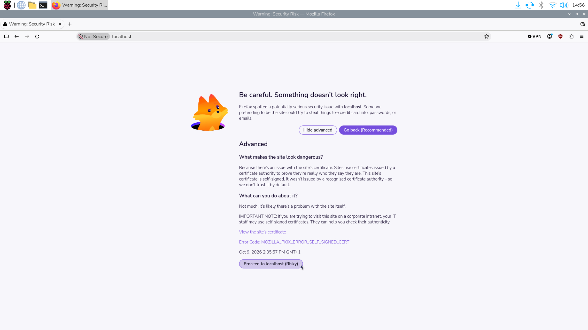

# 4. Installing Eclipse Kura

This procedure installs Eclipse Kura 5.6.2 and Eclipse Temurin JDK 17 on a
Raspberry Pi using the commands below. Run them in order in a terminal on the
Raspberry Pi, either locally or through SSH.

The Kura package is for **64-bit ARM (`aarch64`)**. The Adoptium repository command
uses **`trixie`**, so it must match the operating system's Debian release. Confirm
these prerequisites before continuing. You also need internet access, a user
with `sudo` privileges, and `wget` available for the download step.

## 4.1 Update the Operating System

Refresh the list of available packages and versions from the configured repositories.

```bash
sudo apt update
```

Upgrade installed packages to the newer versions available in those repositories.
Confirm the changes when prompted.

```bash
sudo apt upgrade
```

## 4.2 Download the Kura Installer

Download the Kura 5.6.2 installer for 64-bit ARM and save it in the current directory.

```bash
wget http://download.eclipse.org/kura/releases/5.6.2/kura_5.6.2_generic-aarch64_installer.deb
```

Keep this file in the current directory for the installation step in section 4.4.

## 4.3 Install JDK 17

Install the download tools (`wget` and `curl`), the signing-key tool (`gpg`), and
trusted certificate authorities (`ca-certificates`). The `-y` option automatically
confirms the installation prompt.

```bash
sudo apt install -y wget curl gpg ca-certificates
```

Create the directory where APT will read repository signing keys. The `-p` option
also creates missing parent directories and accepts an existing directory.

```bash
sudo mkdir -p /etc/apt/keyrings
```

Download Adoptium's public signing key, convert it to the binary format used here,
and save it in the keyring directory. APT uses this key to verify packages from
the Adoptium repository; `> /dev/null` hides the copy printed by `tee`.

```bash
curl -fsSL https://packages.adoptium.net/artifactory/api/gpg/key/public | gpg --dearmor | sudo tee /etc/apt/keyrings/adoptium.gpg > /dev/null
```

Allow all users to read the key file, while allowing only its owner to change it.
This lets APT read the signing key.

```bash
sudo chmod 644 /etc/apt/keyrings/adoptium.gpg
```

Add the Adoptium package repository for Debian Trixie to APT's configuration.
The `signed-by` setting tells APT to verify this repository using the key saved above.

```bash
echo "deb [signed-by=/etc/apt/keyrings/adoptium.gpg] https://packages.adoptium.net/artifactory/deb trixie main" | sudo tee /etc/apt/sources.list.d/adoptium.list
```

Refresh the package list again, this time including the newly added Adoptium repository.

```bash
sudo apt update
```

Install Eclipse Temurin JDK 17, which includes the Java runtime and development
tools. The `-y` option automatically confirms the installation prompt.

```bash
sudo apt install -y temurin-17-jdk
```

Display the version of the Java runtime selected by the system. Check that it reports
Java 17.

```bash
java -version
```

Display the version of the Java compiler selected by the system. Check that it
also reports version 17. If either check shows another version, resolve the active
Java selection before continuing.

```bash
javac -version
```

## 4.4 Install Kura and Restart the Device

Install the downloaded Kura package and its dependencies through APT. The `./`
prefix tells APT to use the installer file in the current directory.

```bash
sudo apt-get install ./kura_5.6.2_generic-aarch64_installer.deb
```

Restart the Raspberry Pi after the installation finishes successfully. This also
ends the current SSH session; wait for the device to start before reconnecting.

```bash
sudo reboot
```

## 4.5 Accessing the Administration Interface

After the Raspberry Pi restarts, open the Kura administration console and
complete the initial login setup.

### 4.5.1 Open the Console

Choose the address according to where you are running the browser:

| Browser location | Console address |
| --- | --- |
| On the Raspberry Pi itself | `https://localhost` |
| On another computer that can reach the Raspberry Pi | `https://<ip_address>` |

Replace `<ip_address>` with the Raspberry Pi's IP address. When using another
computer, `localhost` refers to that computer, so use the Raspberry Pi's address.

### 4.5.2 Handle the Certificate Warning

The browser may display a certificate warning, as shown below. Kura's default
HTTPS certificate is self-signed, so the browser cannot automatically verify
the device's identity.



For this initial setup, confirm that the address belongs to your Raspberry Pi,
then open **Advanced** and select **Proceed to localhost** or the equivalent
option for the device's IP address. The wording may vary between browsers.

### 4.5.3 Sign In and Change the Password

For a fresh installation, use the default credentials:

| Field | Value |
| --- | --- |
| Username | `admin` |
| Password | `admin` |

Complete the password-change prompt shown during the initial login. If no prompt
appears, use the user menu to select **Change password**. Set a new password and,
if prompted to sign in again, use the updated credentials.

For further details, consult the [official Kura Raspberry Pi quick start](https://eclipse-kura.github.io/kura/docs-release-5.6/getting-started/raspberry-pi-raspberryos-quick-start/)
and the [Adoptium Linux installation guide](https://adoptium.net/en-GB/installation/linux).
Console access, default credentials, and certificate warnings are covered in the
[Kura administration console guide](https://eclipse-kura.github.io/kura/docs-release-5.6/gateway-configuration/gateway-administration-console/).
